<div align="center">

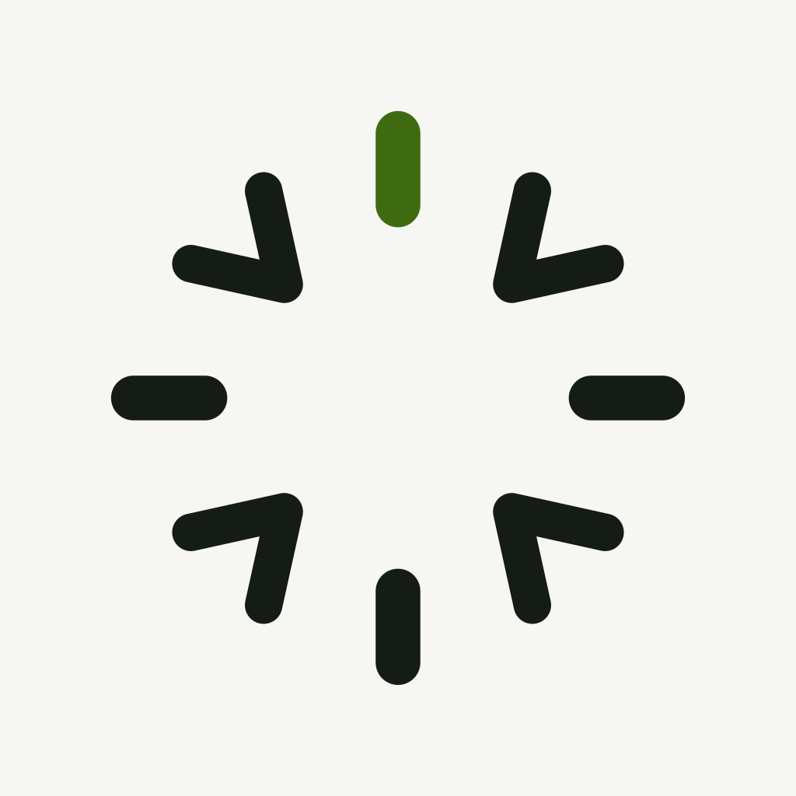

# Nexa

**Compare a espera antes de sair de casa.**

Aplicativo mobile que mostra quanto tempo de fila há nas unidades de saúde perto de você, para você escolher aonde ir antes mesmo de sair.

<br>

[](https://flutter.dev)
[](https://dart.dev)
[](https://github.com/NexaGS/nexa-springboot)
[](#integrantes)
[](#estado-atual-e-limitações)

[Baixar o APK](https://github.com/NexaGS/fe-nexa-app/releases/latest) ·
[Vídeo de apresentação](https://youtu.be/fr3oQiION1I) ·
[Protótipo no Figma](https://www.figma.com/design/AUXujrUnSnl1BxEcAWHdPm/Untitled) ·
[Back-end (Spring Boot)](https://github.com/NexaGS/nexa-springboot) ·
[Documentação](docs/)

<br>

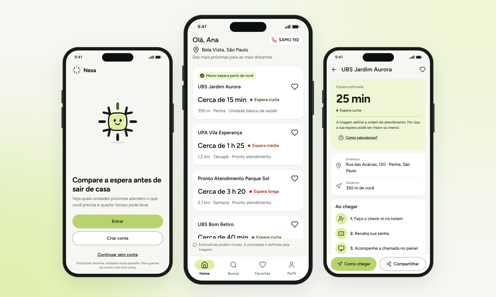

</div>

---

## Índice

- [Sobre o projeto](#sobre-o-projeto)
- [Baixar o app (Android)](#baixar-o-app-android)
- [Telas](#telas)
- [Funcionalidades](#funcionalidades)
- [Como funciona](#como-funciona)
- [Privacidade e LGPD](#privacidade-e-lgpd)
- [Estado atual e limitações](#estado-atual-e-limitações)
- [Tecnologias](#tecnologias)
- [Como rodar](#como-rodar)
- [Estrutura do projeto](#estrutura-do-projeto)
- [Documentação](#documentação)
- [Design e protótipo](#design-e-protótipo)
- [Ferramentas](#ferramentas)
- [Integrantes](#integrantes)
- [Licenças](#licenças)

---

## Sobre o projeto

**Nexa** é um aplicativo que ajuda a pessoa a decidir **qual unidade de saúde procurar** olhando para o **tempo de espera de cada uma**, antes de sair de casa. O projeto nasceu na **Global Solution (CitizenTech) da FIAP** e este repositório é o **aplicativo mobile**, feito em Flutter. O serviço que calcula as esperas fica em outro repositório: [`nexa-springboot`](https://github.com/NexaGS/nexa-springboot).

### O problema

Quem precisa de atendimento não sabe o que vai encontrar. A pessoa pega o ônibus, enfrenta o trânsito, chega ao posto e a fila já está quase na porta. Às vezes havia outra unidade a poucos minutos dali, quase vazia. Esse tempo perdido pesa mais para quem não pode faltar ao trabalho, para quem acompanha os filhos e para quem é idoso.

### A solução

O Nexa mostra o tempo de espera de cada unidade próxima, direto no celular. A pessoa **olha, compara e escolhe**:

1. As unidades aparecem **da mais perto para a mais longe**, cada uma com a espera estimada em uma cor (verde, laranja ou vermelho).
2. A unidade com a **menor espera por perto** ganha um selo.
3. Ao tocar numa unidade, o app mostra o tempo, o endereço, a distância e o passo a passo para quando chegar.
4. O número **se atualiza sozinho**: na unidade há um totem de check-in e, quando alguém chega e se registra, o sistema recalcula a espera.

Em qualquer tela, o botão **SAMU 192** fica à mão para quem tem sintomas graves.

---

## Baixar o app (Android)

<table>
  <tr>
    <td align="center" width="200">
      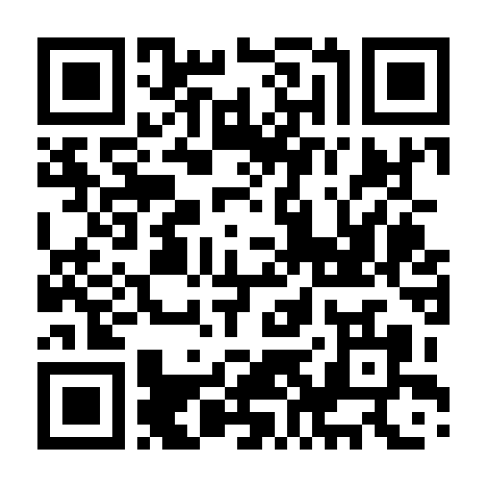<br>
      <sub>Aponte a câmera</sub>
    </td>
    <td>

1. No celular, abra a [página da última versão](https://github.com/NexaGS/fe-nexa-app/releases/latest) e baixe o arquivo **`nexa.apk`** ([download direto](https://github.com/NexaGS/fe-nexa-app/releases/latest/download/nexa.apk)).
2. Toque no arquivo baixado. Se o Android pedir, permita **instalar apps desta fonte**.
3. Se aparecer o aviso do Play Protect, toque em **Instalar mesmo assim** (o app não está na Play Store).
4. Abra o Nexa, crie uma conta e veja as unidades perto de você.

O app já vem configurado para falar com a API hospedada na Azure.

</td>
  </tr>
</table>

---

## Telas

> Imagens ilustrativas das telas do app, com dados fictícios. O protótipo completo está no [Figma](https://www.figma.com/design/AUXujrUnSnl1BxEcAWHdPm/Untitled).

<p align="center"><b>Primeiros passos</b></p>
<table align="center">
  <tr>
    <td align="center">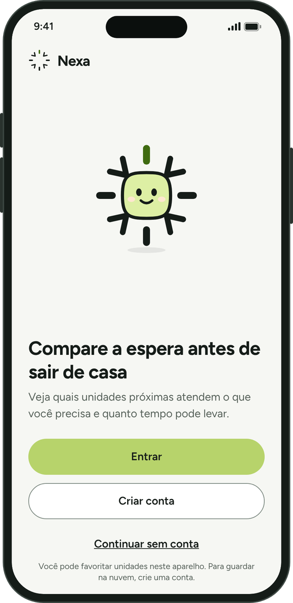<br><sub><b>Início</b></sub></td>
    <td align="center">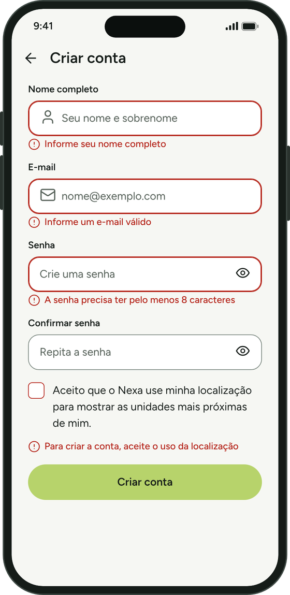<br><sub><b>Criar conta</b></sub></td>
    <td align="center">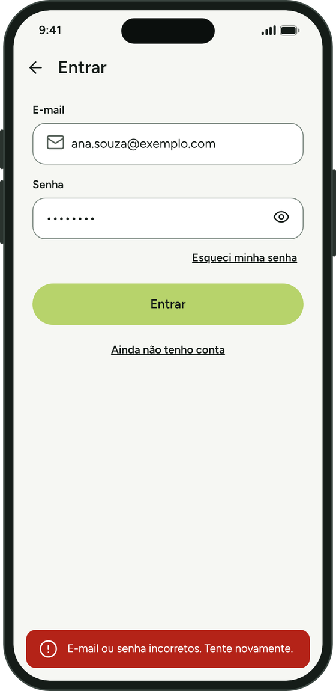<br><sub><b>Entrar</b></sub></td>
  </tr>
</table>

<p align="center"><b>Encontrar e decidir</b></p>
<table align="center">
  <tr>
    <td align="center">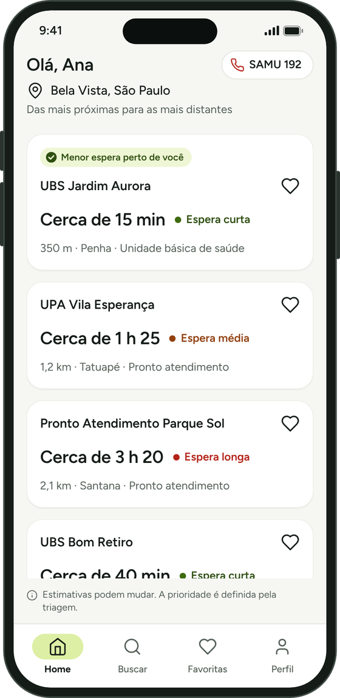<br><sub><b>Home</b></sub></td>
    <td align="center">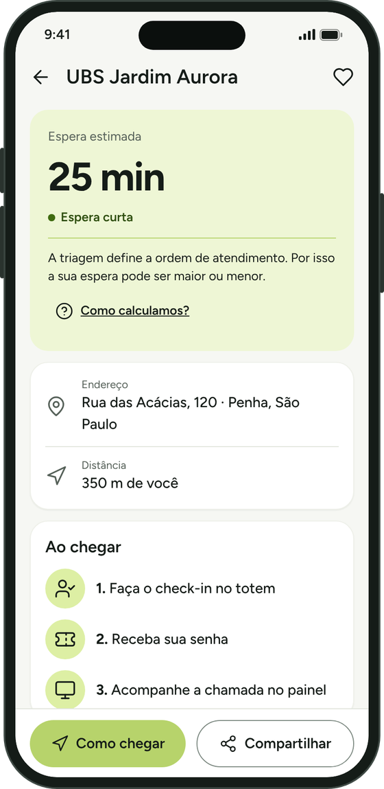<br><sub><b>Detalhe da unidade</b></sub></td>
    <td align="center">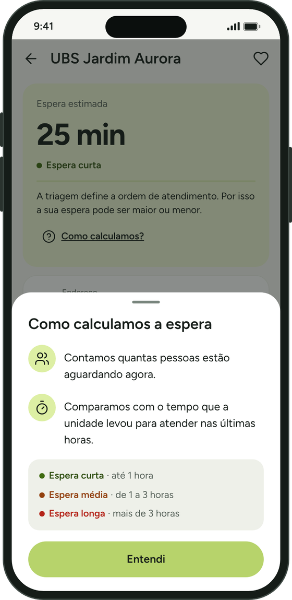<br><sub><b>Como calculamos</b></sub></td>
  </tr>
</table>

<p align="center"><b>No dia a dia</b></p>
<table align="center">
  <tr>
    <td align="center">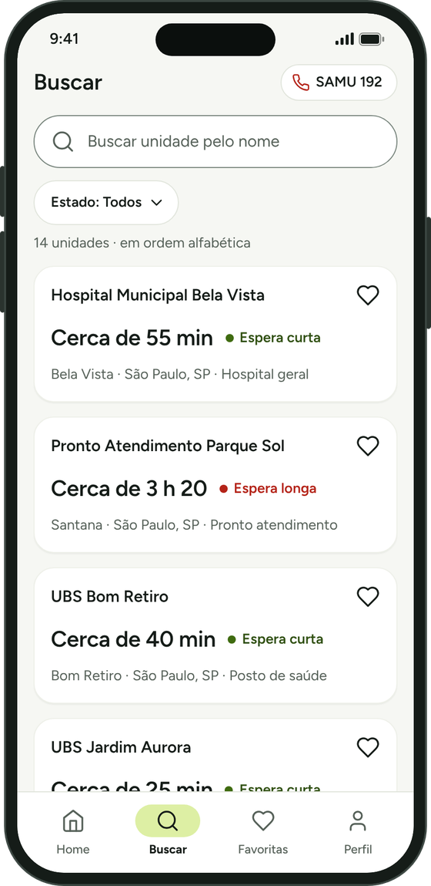<br><sub><b>Buscar</b></sub></td>
    <td align="center">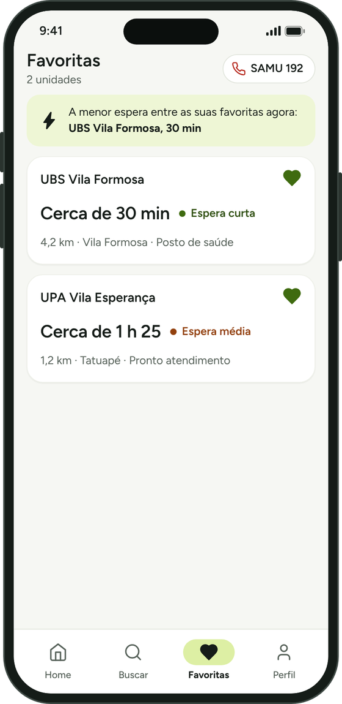<br><sub><b>Favoritas</b></sub></td>
    <td align="center">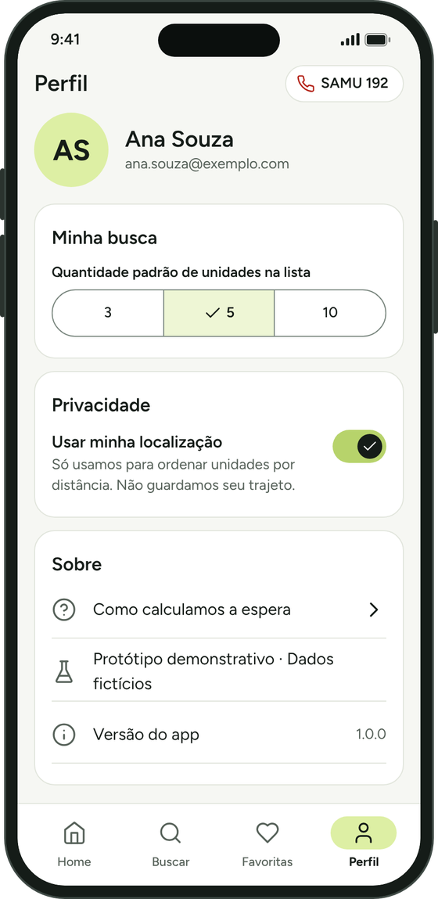<br><sub><b>Perfil</b></sub></td>
  </tr>
</table>

---

## Funcionalidades

**Conta e acesso**

- **Entrar**, **Criar conta** ou **Continuar sem conta**.
- Validação em cada campo: nome completo, e-mail válido, senha de pelo menos 8 caracteres, confirmação da senha e aceite do uso da localização.
- O app avisa quando as senhas são diferentes, quando o e-mail já existe (e sugere entrar) e quando o e-mail ou a senha estão incorretos.

**Encontrar uma unidade**

- **Home**: unidades da mais próxima para a mais distante, com a espera em um chip colorido e o selo de **menor espera perto de você**.
- **Buscar**: procura por nome e filtro por estado.
- **SAMU 192** sempre à mão, com ligação direta.

**Decidir e ir**

- **Detalhe** da unidade: espera estimada, endereço, distância e o passo a passo **Ao chegar** (check-in no totem, senha e painel de chamada).
- **Como chegar** (abre a rota no mapa) e **Compartilhar**.
- **Como calculamos a espera**: explicação simples de onde vem o número, com a legenda das cores.

**Acompanhar**

- **Favoritas**: sem conta, ficam guardadas no aparelho; com conta, ficam na conta e voltam ao entrar de novo, inclusive em outro dispositivo.
- **Perfil**: preferências (quantidade padrão de unidades na lista e uso da localização) e **Sair** com confirmação.
- A espera **se atualiza sozinha**, sem a pessoa fazer nada.

| Cor do chip | Significado |
| --- | --- |
| Verde | Espera curta: até 1 hora |
| Laranja | Espera média: de 1 a 3 horas |
| Vermelho | Espera longa: mais de 3 horas |

---

## Como funciona

O Nexa tem três partes que conversam entre si:

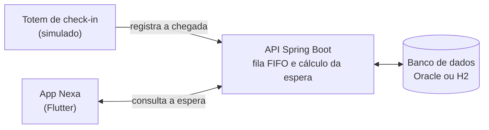

| Parte | O que faz |
| --- | --- |
| **Totem de check-in** | Registra a chegada de quem chega à unidade. Hoje é **simulado de forma digital**. |
| **API Spring Boot** | Recebe o check-in, mantém a fila de cada serviço por ordem de chegada (FIFO), grava no banco (Oracle ou H2) e **calcula o tempo de espera**. |
| **App Nexa (Flutter)** | Consulta a API, mostra as unidades e as esperas e se atualiza sozinho. |

**Como a espera é calculada.** O back-end conta quantas pessoas estão aguardando na fila e estima o tempo: a regra atual considera **20 minutos por pessoa** aguardando. O app sempre avisa que é uma **estimativa**, porque quem define a ordem de atendimento é a **triagem**.

**Atualização automática.** Enquanto a tela está aberta, o app busca os números novos sozinho (`AtualizadorPeriodico`):

| Tela | Intervalo |
| --- | --- |
| Home, Favoritas e Detalhe | a cada 20 segundos |
| Buscar | a cada 30 segundos |

**Endpoints usados pelo app**

| Método | Rota | Para quê |
| --- | --- | --- |
| `POST` | `/api/auth/registro` | Criar conta |
| `POST` | `/api/auth/login` | Entrar |
| `GET` | `/api/unidades/proximas` | Unidades próximas, da mais perto para a mais longe |
| `GET` | `/api/unidades` | Catálogo (Buscar) |
| `GET` | `/api/unidades/{id}` | Detalhe de uma unidade |
| `GET` | `/api/localizacoes/reversa` | Nome do bairro e da cidade a partir da posição |
| `GET` `PUT` `DELETE` | `/api/cidadaos/usuario/favoritas` (e `adicionarUnidade/{id}`, `removerUnidade/{id}`) | Favoritas da conta |

---

## Privacidade e LGPD

O Nexa guarda só o que realmente usa, como a LGPD pede:

- **Não pede CPF.** Para criar a conta bastam nome, e-mail e senha, além do aceite do uso da localização.
- A **localização** só é usada se a pessoa aceitar, e **somente para ordenar as unidades por distância**. O trajeto não é guardado.
- A senha é protegida com **BCrypt** no back-end, e a sessão usa um **token JWT** que vale 8 horas, guardado no armazenamento seguro do aparelho (`flutter_secure_storage`).
- Quem prefere pode **seguir sem conta**: as favoritas ficam só no aparelho.

---

## Estado atual e limitações

- É um **protótipo funcional** feito para a Global Solution. As unidades e os dados mostrados são **fictícios**.
- O **totem de check-in é simulado**; não há equipamento físico na unidade.
- A espera é uma **estimativa simples** (regra atual de 20 minutos por pessoa aguardando) e **não substitui a triagem**, que define a ordem real de atendimento.
- O app precisa do back-end no ar para mostrar as unidades; sem ele aparece a mensagem de **sem conexão**.

---

## Tecnologias

| Camada | Tecnologias |
| --- | --- |
| **App mobile** | Flutter e Dart `^3.12.2` |
| **Pacotes do app** | `http`, `geolocator`, `url_launcher`, `share_plus`, `shared_preferences`, `flutter_secure_storage`, `package_info_plus`, `flutter_svg`, `lottie` |
| **Back-end** | Java 21, Spring Boot, Spring Data JPA, Spring Security com JWT, banco Oracle ou H2 (veja o [repositório do back-end](https://github.com/NexaGS/nexa-springboot)) |
| **Design** | Figma, fonte Figtree, ícones SVG e o mascote **Guia** (Lottie e SVG) |
| **Qualidade** | `flutter analyze` e `flutter test` |
| **Apoio ao desenvolvimento** | Claude + MCP do Figma (veja [Ferramentas](#ferramentas)) |

---

## Como rodar

O app conversa com o back-end, então o ideal é subir o back-end primeiro.

### 1. Back-end

```bash
git clone https://github.com/NexaGS/nexa-springboot.git
cd nexa-springboot
./mvnw spring-boot:run        # no Windows: .\mvnw.cmd spring-boot:run
```

Por padrão ele usa o banco **H2 em memória**, já com dados de demonstração, e fica em `http://localhost:8080`. Outras opções (Oracle, variáveis de ambiente, documentação Swagger) estão no README do back-end.

### 2. App

Pré-requisitos: **Flutter SDK** com Dart `^3.12.2` (confira com `flutter --version`) e um celular Android com depuração USB ou um emulador.

```bash
git clone https://github.com/NexaGS/fe-nexa-app.git
cd fe-nexa-app
flutter pub get                 # baixa os pacotes
adb reverse tcp:8080 tcp:8080   # espelha a porta do back-end no aparelho (com ele conectado)
flutter run                     # roda no aparelho ou no emulador
```

O endereço da API vem de `API_BASE_URL` (padrão `http://localhost:8080`, que funciona com o `adb reverse` acima). Para usar outro endereço, passe no `flutter run`:

| Situação | Comando |
| --- | --- |
| Celular com `adb reverse` (padrão) | `flutter run` |
| Emulador Android, sem o `adb reverse` | `flutter run --dart-define=API_BASE_URL=http://10.0.2.2:8080` |
| Celular na mesma rede Wi-Fi | `flutter run --dart-define=API_BASE_URL=http://192.168.0.10:8080` (use o IP do seu computador) |

### Qualidade

```bash
flutter analyze      # corretor do código; o ideal é "No issues found!"
flutter test         # testes automáticos
```

> Mudou o `pubspec.yaml` (pacotes, assets ou fontes)? Pare o app e rode de novo; o hot reload não pega essas mudanças.

---

## Estrutura do projeto

```text
fe-nexa-app/
├── android/ · ios/        projetos nativos gerados pelo Flutter
├── assets/
│   ├── fonts/             Figtree (4 pesos) + licença OFL
│   ├── guia/              mascote Guia: lottie/ (animações) e poses/ (SVG)
│   ├── icons/             ícones SVG de 24 px
│   └── images/            logo_mark.svg
├── docs/
│   ├── img/               imagens deste README
│   ├── marca/             ícone e splash animado do Nexa
│   └── *.md               arquitetura, design system e assets
├── lib/
│   ├── main.dart          ponto de entrada
│   ├── app/               MaterialApp, tema (cores, textos, tokens) e endereço da API
│   ├── features/          uma pasta por assunto
│   │   ├── splash/        animação de abertura
│   │   ├── inicio/        Entrar, Criar conta ou seguir sem conta
│   │   ├── auth/          Entrar, Criar conta e sessão (JWT)
│   │   ├── home/          unidades da mais perto para a mais longe
│   │   ├── unidades/      detalhe da unidade, cartão e "Como calculamos"
│   │   ├── busca/         busca por nome e filtro por estado
│   │   ├── favoritas/     favoritas (no aparelho ou na conta)
│   │   └── perfil/        preferências, privacidade e sair
│   ├── shared/            componentes e utilitários usados em várias telas
│   └── galeria/           galerias dos componentes, para desenvolvimento
├── test/                  testes automáticos (seguem a estrutura de lib/)
└── pubspec.yaml
```

---

## Documentação

| Documento | Conteúdo |
| --- | --- |
| [`docs/arquitetura.md`](docs/arquitetura.md) | Princípios, camadas, convenções, decisões e integração com o Spring |
| [`docs/design-system.md`](docs/design-system.md) | Cores, textos, raios, tamanhos e sombras (do Figma para o código) |
| [`docs/assets.md`](docs/assets.md) | Guia, logo, ícones, fonte, licenças e como carregar cada tipo |

---

## Design e protótipo

- **Protótipo no Figma:** <https://www.figma.com/design/AUXujrUnSnl1BxEcAWHdPm/Untitled>
- **Vídeo de apresentação:** <https://youtu.be/fr3oQiION1I>

---

## Ferramentas

| Ferramenta | Para quê |
| --- | --- |
| Flutter e Dart | O app mobile (este repositório) |
| Spring Boot (Java) | O back-end, em [repositório próprio](https://github.com/NexaGS/nexa-springboot) |
| Figma | O design das telas e o protótipo |
| Claude + MCP | Assistente de desenvolvimento (veja abaixo) |

### Claude + MCP no desenvolvimento

O projeto foi desenvolvido com o apoio do **Claude** (Anthropic) como assistente de programação. O **MCP** (Model Context Protocol) é o padrão que conecta o Claude a outras ferramentas. Aqui, o MCP do **Figma** deixa o Claude ler as telas, os componentes e as cores direto do arquivo do protótipo e escrever o código a partir deles, em vez de depender de descrições soltas.

O Claude ajudou a:

- transformar as telas do Figma em componentes e telas em Flutter;
- escrever os testes e as galerias dos componentes;
- escrever e atualizar a documentação em [`docs/`](docs/);
- revisar o código e a integração com o Spring.

O que o Claude escreve passa pela revisão da equipe: a equipe roda `flutter analyze` e `flutter test`, decide o que entra e faz o versionamento (`add`, `commit` e `push`).

---

## Integrantes

Projeto da **Global Solution (CitizenTech)** da FIAP.

| Nome | RM | Turma |
| :--- | :--- | :--- |
| Paulo Cavalcante Caroba | RM566667 | 2TDSPS |
| Renan da Silva Paulino | RM566610 | 2TDSPS |
| Sergio Henrique da Silva Santos | RM567254 | 2TDSPS |

---

## Licenças

- **Figtree**: SIL Open Font License 1.1. O texto da licença está em [`assets/fonts/OFL.txt`](assets/fonts/OFL.txt).
- **Ícones**: desenhados no estilo do conjunto Lucide (licença ISC). Confirme a origem antes de publicar o app; veja [`docs/assets.md`](docs/assets.md).
- **Guia e logo**: criação própria do projeto.
